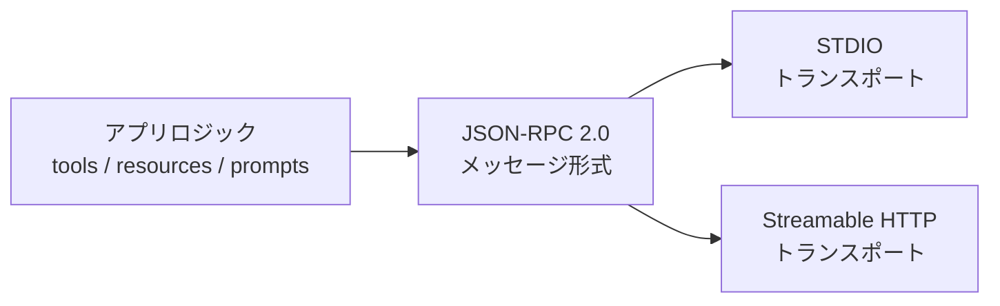
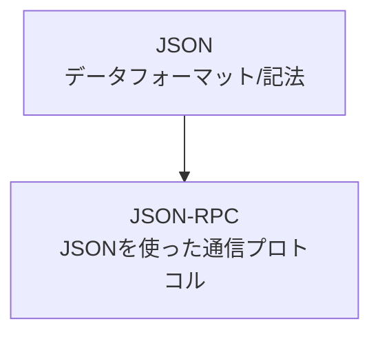
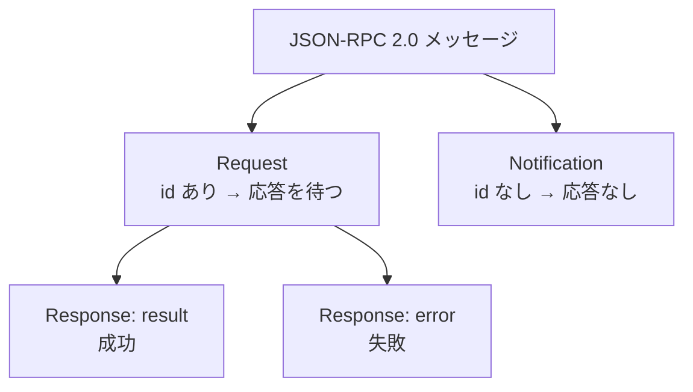
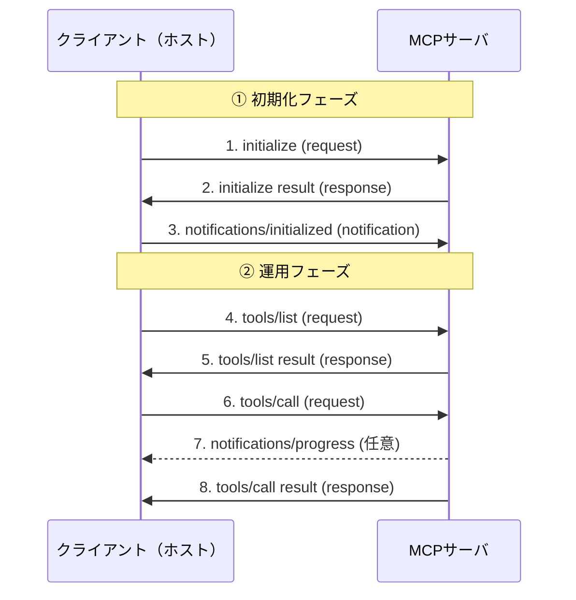
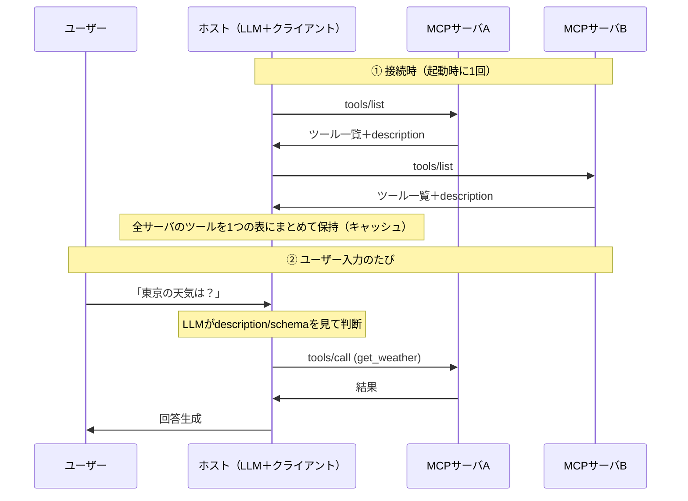

# 趣旨

MCP（Model Context Protocol）サーバとの通信は **JSON-RPC 2.0** メッセージを、**STDIO** または **Streamable HTTP** といったトランスポートで運ぶ、という構造になっている。本記事では「なぜ両方のトランスポートが使えるのか」から「実際にやり取りされるメッセージの中身」「複数サーバからのツール選択」までを段階的に整理する。

---

## 1. 3層構造で捉える

MCP の通信は、次の3つのレイヤーに分けて考えると理解しやすい。



| レイヤー | 役割 | 例 |
|---|---|---|
| アプリロジック | 実際の処理（ツールの中身） | `get_weather` の実装 |
| JSON-RPC 2.0 | メッセージの「形」と呼び出しルール | `method` / `params` / `id` |
| トランスポート | メッセージの運搬経路 | STDIO / Streamable HTTP |

**JSON-RPC（中身）とトランスポート（運搬）が分離されている**ことが、以降のすべての話の土台になる。

---

## 2. なぜ STDIO と Streamable HTTP の両方が使えるのか

JSON-RPC はトランスポートに依存しないメッセージ形式なので、**中身が同じまま運搬経路だけを差し替えられる**。MCP 仕様は、このトランスポートを差し替え可能（pluggable）に設計している。

| | STDIO | Streamable HTTP |
|---|---|---|
| 通信経路 | 標準入出力（stdin/stdout） | HTTP POST +（必要なら）SSE ストリーム |
| 想定用途 | ローカルの子プロセスとして起動 | リモート/ネットワーク越し、複数クライアント |
| 起動形態 | クライアントがプロセスを spawn | サーバが HTTP エンドポイントを listen |
| 認証・セッション | 基本不要（ローカル前提） | OAuth 等・セッション管理が絡む |

### どのトランスポートに対応するかを決めるのは誰か

**サーバの実装・起動方法の段階で決まる。**

- 多くのサーバは片方だけ対応して起動する（STDIO で待ち受ける／特定ポートで HTTP を listen する）。
- 公式 SDK はトランスポートを抽象化しているため、**同じツール実装コードのまま「STDIO で起動」「HTTP で起動」を選べる**。ただしその場合でも、起動時にどのトランスポートで待ち受けるかは決めて立ち上げる。
- クライアント側の「サーバ定義」は、そのサーバが待ち受けているトランスポートに合わせて記述する（VS Code の `mcp.json` なら `command` を書けば STDIO、`url` / `type: http` を書けば Streamable HTTP）。

### SDK による抽象化の例（Python）

```python
from mcp.server.fastmcp import FastMCP

mcp = FastMCP("my-server")

@mcp.tool()
def add(a: int, b: int) -> int:
    return a + b

if __name__ == "__main__":
    # ツール定義（add）は変えずに、トランスポートだけ差し替える
    mcp.run(transport="stdio")               # STDIO で待ち受け
    # mcp.run(transport="streamable-http")   # HTTP で待ち受け
```

`add` の実装は一切変えずに、最後の `run(transport=...)` を差し替えるだけで運搬経路が変わる。

> 注意点
> - 「両方対応の抽象化がある」＝「1プロセスで同時に両方 listen する」ではない。通常は起動時に片方を選ぶ。
> - 抽象化されているのは公式 SDK を使った場合。STDIO 専用に書かれたサーバはそのままでは HTTP を話せない。
> - HTTP で公開する場合はセッション管理・認証・複数クライアント対応などが追加で必要になる。

---

## 3. JSON と JSON-RPC の違い

- **JSON** … データの書き方（記法）そのもの。意味やルールは決めていない。
- **JSON-RPC** … その JSON を使った「遠隔手続き呼び出し（RPC）のルール（プロトコル）」。フィールドの形が仕様で固定されている。



ただの JSON:

```json
{ "a": 1, "b": 2 }
```

JSON-RPC 2.0 のリクエスト（形が決まっている）:

```json
{
  "jsonrpc": "2.0",
  "method": "add",
  "params": { "a": 1, "b": 2 },
  "id": 1
}
```

つまり JSON-RPC は **「スキーマ（形）が決められた JSON メッセージ」＋「呼び出し・応答・エラーのやり取りルール」** がセットになったもの。保存する「ファイル」ではなく、通信でリクエストとレスポンスがペアで往復する「メッセージ」である点も普通の JSON との違い。

---

## 4. Web API（REST）との違い

JSON を使っていても、JSON-RPC のルールに従っていなければ JSON-RPC ではない。多くの Web API（REST）は「JSON をやり取りしているだけ」で JSON-RPC ではない。

| | REST API（一般的な Web API） | JSON-RPC |
|---|---|---|
| 何をするか（動詞） | HTTP メソッド（GET/POST/PUT/DELETE） | JSON 内の `method` フィールド |
| 何に対して（対象） | URL のパス（`/users/1`） | `params` の中身 |
| エンドポイント | 対象ごとに複数 | 基本1つ（全部そこに POST） |
| JSON ボディの形 | **API 実装者が自由に決める** | **プロトコルで固定**（`jsonrpc`/`method`/`params`/`id`） |
| 決まりの出どころ | そのAPIのドキュメント（実装ごと） | JSON-RPC 2.0 仕様（共通標準） |

同じ「ユーザーを作る」処理:

**REST API** — 動詞は HTTP、対象は URL、ボディは自由:

```http
POST /users
Content-Type: application/json

{ "name": "koishizu" }
```

**JSON-RPC** — 動詞も対象も JSON の中。URL は基本1つ:

```http
POST /rpc
Content-Type: application/json

{
  "jsonrpc": "2.0",
  "method": "createUser",
  "params": { "name": "koishizu" },
  "id": 1
}
```

### なぜ MCP は JSON-RPC を選んだか

REST は HTTP（URL＋メソッド）に依存した設計だが、MCP は STDIO のような HTTP 以外のトランスポートでも動かしたい。JSON-RPC は **トランスポートに依存せず、JSON 本文だけで呼び出しが完結する**ため、STDIO でも HTTP でも同じメッセージがそのまま使える。さらに「外枠（封筒）は仕様で固定、中身（`params`）だけ自由」なので、**クライアントはどんなサーバでも共通の流儀で扱える**という汎用性が得られる。

---

## 5. JSON-RPC 2.0 のスキーマ

### Request（応答を期待する呼び出し）

```json
{
  "jsonrpc": "2.0",
  "method": "subtract",
  "params": [42, 23],
  "id": 1
}
```

| フィールド | 必須 | 型 | 説明 |
|---|---|---|---|
| `jsonrpc` | ✅ | string | 必ず `"2.0"` の固定値 |
| `method` | ✅ | string | 呼び出すメソッド名。`rpc.` 始まりは予約 |
| `params` | 任意 | array / object | 引数。位置指定なら配列、名前指定ならオブジェクト |
| `id` | ✅ | string / number / null | リクエストとレスポンスの紐づけ用（`null` は非推奨） |

### Notification（応答を期待しない）

`id` を付けないだけ。サーバは返信してはいけない。

```json
{
  "jsonrpc": "2.0",
  "method": "update",
  "params": [1, 2, 3, 4, 5]
}
```

### Response（成功時）

```json
{
  "jsonrpc": "2.0",
  "result": 19,
  "id": 1
}
```

`result` は成功時は必須、失敗時は含めない。`id` は対応する Request の `id` と一致させる。

### Response（失敗時）

`result` の代わりに `error` を返す（`result` と `error` は排他）。

```json
{
  "jsonrpc": "2.0",
  "error": {
    "code": -32601,
    "message": "Method not found",
    "data": { "detail": "..." }
  },
  "id": 1
}
```

| フィールド | 必須 | 型 | 説明 |
|---|---|---|---|
| `code` | ✅ | number（整数） | エラーコード |
| `message` | ✅ | string | 短い説明文 |
| `data` | 任意 | any | 追加情報 |

### 定義済みエラーコード

| code | 意味 | 説明 |
|---|---|---|
| `-32700` | Parse error | JSON として壊れている |
| `-32600` | Invalid Request | JSON-RPC の形として不正 |
| `-32601` | Method not found | そのメソッドが無い |
| `-32602` | Invalid params | 引数が不正 |
| `-32603` | Internal error | サーバ内部エラー |
| `-32000`〜`-32099` | Server error | 実装側で自由に使える予約枠 |

### Batch（複数まとめて送る）

配列で複数メッセージを一度に送れる。

```json
[
  { "jsonrpc": "2.0", "method": "sum", "params": [1,2,4], "id": "1" },
  { "jsonrpc": "2.0", "method": "notify_hello", "params": [7] },
  { "jsonrpc": "2.0", "method": "subtract", "params": [42,23], "id": "2" }
]
```

> **MCP に関する補足**: MCP では 2025-06-18 の仕様改訂で JSON-RPC のバッチ（配列送信）はサポート対象外になった。MCP では 1 メッセージずつやり取りするのが前提。



---

## 6. MCP セッションで実際にやり取りされるメッセージ

MCP は「初期化フェーズ」→「運用フェーズ」の順に進む。



### ① 初期化フェーズ

**【1】Client → Server：`initialize`（Request）**

```json
{
  "jsonrpc": "2.0",
  "id": 1,
  "method": "initialize",
  "params": {
    "protocolVersion": "2025-06-18",
    "capabilities": {
      "roots": { "listChanged": true },
      "sampling": {}
    },
    "clientInfo": { "name": "VS Code", "version": "1.100.0" }
  }
}
```

**【2】Server → Client：`initialize` の結果（Response）**

```json
{
  "jsonrpc": "2.0",
  "id": 1,
  "result": {
    "protocolVersion": "2025-06-18",
    "capabilities": {
      "tools": { "listChanged": true },
      "resources": { "subscribe": true },
      "prompts": {}
    },
    "serverInfo": { "name": "my-mcp-server", "version": "0.1.0" }
  }
}
```

**【3】Client → Server：`notifications/initialized`（Notification）**

```json
{
  "jsonrpc": "2.0",
  "method": "notifications/initialized"
}
```

### ② 運用フェーズ

**【4】Client → Server：`tools/list`（Request）**

```json
{
  "jsonrpc": "2.0",
  "id": 2,
  "method": "tools/list"
}
```

**【5】Server → Client：`tools/list` の結果（Response）**

```json
{
  "jsonrpc": "2.0",
  "id": 2,
  "result": {
    "tools": [
      {
        "name": "get_weather",
        "description": "指定都市の現在の天気を返す",
        "inputSchema": {
          "type": "object",
          "properties": {
            "city": { "type": "string", "description": "都市名" }
          },
          "required": ["city"]
        }
      }
    ]
  }
}
```

**【6】Client → Server：`tools/call`（Request）**

```json
{
  "jsonrpc": "2.0",
  "id": 3,
  "method": "tools/call",
  "params": {
    "name": "get_weather",
    "arguments": { "city": "Tokyo" }
  }
}
```

**【7】Server → Client：`notifications/progress`（Notification・任意）**

```json
{
  "jsonrpc": "2.0",
  "method": "notifications/progress",
  "params": { "progressToken": "abc123", "progress": 50, "total": 100 }
}
```

**【8】Server → Client：`tools/call` の結果（Response）**

```json
{
  "jsonrpc": "2.0",
  "id": 3,
  "result": {
    "content": [
      { "type": "text", "text": "東京は現在 25℃、晴れです。" }
    ],
    "isError": false
  }
}
```

**エラー時（【8】の代替）**

```json
{
  "jsonrpc": "2.0",
  "id": 3,
  "error": {
    "code": -32602,
    "message": "Invalid params",
    "data": { "reason": "city が指定されていません" }
  }
}
```

### 段階のまとめ

| 段階 | メッセージ | 種類 | id | 向き |
|---|---|---|---|---|
| 初期化 | `initialize` | Request | 1 | C→S |
| 初期化 | initialize 結果 | Response | 1 | S→C |
| 初期化 | `notifications/initialized` | Notification | なし | C→S |
| 運用 | `tools/list` | Request | 2 | C→S |
| 運用 | tools/list 結果 | Response | 2 | S→C |
| 運用 | `tools/call` | Request | 3 | C→S |
| 運用 | `notifications/progress` | Notification | なし | S→C |
| 運用 | tools/call 結果 | Response | 3 | S→C |

ポイント:
1. 必ず `initialize` の握手から始まる（バージョンと capabilities のすり合わせ）。
2. `id` あり＝返信を待つ / `id` なし＝通知（返信不要）。
3. 中身の JSON（`arguments` や `content`）だけがツール固有で、外枠は全ツール共通。

---

## 7. 複数の MCP サーバからのツール選択

複数サーバがある場合、「どのツールを呼ぶか」を選ぶのは **LLM（推論）側**であり、MCP プロトコルの仕事ではない。



### 誤解しやすいポイント

- **ユーザー入力のたびに全サーバへ `tools/list` を投げるわけではない。** `tools/list` は基本、接続確立時（initialize 後）に一度だけ呼び、結果をクライアント側でキャッシュする。
- サーバが `tools: { listChanged: true }` を持つ場合、ツールが増減すると次の通知が飛ぶ。これを受け取ったときにクライアントが改めて `tools/list` を呼び直してキャッシュを更新する。

```json
{ "jsonrpc": "2.0", "method": "notifications/tools/list_changed" }
```

### ツール選択の流れ

1. クライアントが全 MCP サーバのツール定義を1つのリストに統合する。
2. そのリスト（`name` + `description` + `inputSchema`）を LLM に「使える道具一覧」として渡す。
3. LLM がユーザー入力と `description` / `inputSchema` を照らし合わせ、「どのツールを、どの引数で呼ぶか」を決定する（tool calling）。
4. クライアントがその決定を該当サーバへの `tools/call` に変換して送信する。

### 分担のまとめ

| 項目 | 実際の挙動 |
|---|---|
| `tools/list` のタイミング | 接続時に1回（＋変更通知時に再取得）。毎入力ではない |
| ツール定義の保持 | クライアントがキャッシュし、全サーバ分を統合 |
| どのツールを呼ぶか判断 | LLM が description / inputSchema を見て決定 |
| `tools/call` の送信先 | LLM の決定に従いクライアントが該当サーバへ |

> `description` の質が重要。LLM は description を根拠にツールを選ぶため、曖昧だと誤選択や未呼び出しが起きる。似た機能のツールが複数サーバにある場合は、用途・使い分けを明確に書く。

---

## まとめ

- MCP の通信は **アプリロジック / JSON-RPC / トランスポート** の3層で捉える。
- **JSON-RPC** は「スキーマが固定された JSON メッセージ＋呼び出しルール」。トランスポート非依存なので STDIO でも HTTP でも同じメッセージが使える。
- どのトランスポートで待ち受けるかは **サーバの起動時**に決まる。公式 SDK はトランスポートを抽象化しており、コードを変えずに差し替えできる。
- REST と違い、JSON-RPC はボディの「外枠」が仕様で固定され、`params` の中身だけが自由。これにより **クライアントはどんなサーバでも共通の流儀で扱える**。
- セッションは必ず `initialize` の握手から始まり、`id` の有無で「応答を待つ／待たない」を区別する。
- 複数サーバのツール選択は、クライアントがキャッシュした全ツール定義をもとに **LLM が description を見て判断**する。

---

## 参考リンク

- [JSON-RPC 2.0 Specification](https://www.jsonrpc.org/specification)
- [Model Context Protocol 仕様](https://modelcontextprotocol.io/specification)
- [MCP: Tools](https://modelcontextprotocol.io/docs/concepts/tools)
