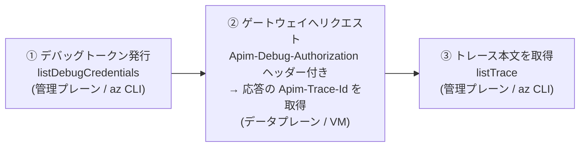

:::message
本記事は筆者個人の検証結果に基づくものであり、所属する組織の公式見解を示すものではありません。正確な情報や最新の仕様については、公式ドキュメントをご確認ください。
:::

# はじめに

Azure API Management（APIM）を AI Gateway として使っていると、バックエンド（Azure OpenAI など）へのリクエストが `HTTP 500` で返ってくることがあります。しかも応答ボディは `statusCode` / `message` / `activityId` だけ——**どのポリシーで何が起きたのかがまったく分からない**、というやつです。

本記事では、APIM の **API Inspector（トレース）機能**を使って、ポリシー実行を 1 行ずつ追いかけ、例外を出しているポリシーをピンポイントで特定する手順を紹介します。Internal VNet 構成の APIM でハマりやすいポイントも含めてまとめました。

> 参考: [API のデバッグ / トレース（API Inspector）](https://learn.microsoft.com/ja-jp/azure/api-management/api-management-howto-api-inspector)

---

# TL;DR

- APIM の汎用 500（`statusCode` / `message` / `activityId` だけ）は、**ポリシー内で例外が起きているサイン**。
- トレースは **管理プレーン（`az CLI`）とデータプレーン（ゲートウェイ）を行き来する 3 ステップ**。
- Internal VNet 構成では、**ゲートウェイへのリクエストだけ VNet 内の VM から**実行する必要がある。
- トレース本文（`listTrace`）を見れば、例外を出したポリシー行がそのまま読める。

---

# 前提

この記事のコマンドは、以下のような環境を想定しています。値はご自身の環境に合わせて読み替えてください。プレースホルダーは `<...>` で示します。

| 項目 | プレースホルダー | 補足 |
| --- | --- | --- |
| Subscription ID | `<subscription-id>` | GUID |
| Resource Group | `<resource-group>` | APIM のあるリソースグループ |
| APIM サービス名 | `<apim-name>` | |
| ゲートウェイホスト | `<apim-name>.azure-api.net` | Internal VNet ならプライベート FQDN |
| 対象 API（完全修飾 apiId） | `/subscriptions/<subscription-id>/resourceGroups/<resource-group>/providers/Microsoft.ApiManagement/service/<apim-name>/apis/<api-id>` | |
| API path | `<api-path>` | 例: `v1` |
| サブスクリプションキーヘッダー | `<subscription-key-header>` | 例: `api-key` |
| api-version | `2024-05-01`（トレース系 REST）/ `2024-10-21`（チャット補完） | |

事前に `az login` 済みで、対象サブスクリプションが選択されていることを前提とします。

---

# 全体像：3 ステップで例外を特定する

トレースの流れは 3 ステップです。**管理プレーン（`az CLI`）とデータプレーン（ゲートウェイ）を行き来する**のがポイントです。



:::message
**Internal VNet の注意**
APIM が `virtualNetworkType=Internal` の場合、ゲートウェイ（②）は VNet 内からしか到達できません。そのため **②だけは VNet 内の VM（bash）で実行**します。①③は管理プレーン（Azure Resource Manager）経由なのでどこからでも実行可能です。
:::

---

# ① デバッグトークンを発行する（az CLI）

REST API `listDebugCredentials` を呼び出して、トレース用のデバッグトークンを発行します。

:::message alert
**ハマりどころ**: `apiId` は**完全修飾 ID** が必須です。`/apis/<api-id>` のような短縮形だと `400 LinkedInvalidPropertyId` になります。
:::

bash ならシングルクォートで JSON をそのまま渡せるので、ファイルを作らずに一行で実行できます。発行したトークンをそのまま変数 `$DBG` に格納しておきます。

```bash
DBG=$(az rest --method post \
  --url "https://management.azure.com/subscriptions/<subscription-id>/resourceGroups/<resource-group>/providers/Microsoft.ApiManagement/service/<apim-name>/gateways/managed/listDebugCredentials?api-version=2024-05-01" \
  --headers "Content-Type=application/json" \
  --body '{"credentialsExpireAfter":"PT1H","apiId":"/subscriptions/<subscription-id>/resourceGroups/<resource-group>/providers/Microsoft.ApiManagement/service/<apim-name>/apis/<api-id>","purposes":["tracing"]}' \
  --query token -o tsv)
```

この `$DBG` を、次の②で `Apim-Debug-Authorization` ヘッダーにそのまま使えます（同じ VM の bash なら①→②を連続実行できます）。

発行されるトークンの形式（`ex` が失効時刻 UTC）:

```text
aid=<api-id>&iss=...&p=tracing&ex=<yyyyMMddHHmmss>&sn=...
```

---

# ② ゲートウェイへリクエストする（VM 内 bash）

発行したトークンを `Apim-Debug-Authorization` ヘッダーに付けて、通常どおりチャット補完を呼び出します。応答ヘッダーに `Apim-Trace-Id` が返ってくるので、`-i` でヘッダーごと表示します。

:::message alert
**ハマりどころ**
- `$APIM_URL` に `https://` を**含めない**（URL 側と二重にならないように）。
- トークンは**シングルクォート**で囲む（`&` や `%` をシェルに解釈させない）。
:::

```bash
curl -i -X POST \
  "https://$APIM_URL/<api-path>/openai/deployments/<deployment-name>/chat/completions?api-version=2024-10-21" \
  -H "Content-Type: application/json" \
  -H "<subscription-key-header>: $SUBSCRIPTION_KEY" \
  -H "Apim-Debug-Authorization: $DBG" \
  -d '{"messages":[{"role":"user","content":"こんにちは"}]}'
```

応答ヘッダーから `Apim-Trace-Id` の値を控えておきます。

```text
Apim-Trace-Id: <trace-id>
```

---

# ③ トレース本文を取得する（az CLI）

`listTrace` に `traceId` を渡すと、`inbound` / `backend` / `outbound` の各ポリシー実行ログ（JSON）が返ります。

```bash
az rest --method post \
  --url "https://management.azure.com/subscriptions/<subscription-id>/resourceGroups/<resource-group>/providers/Microsoft.ApiManagement/service/<apim-name>/gateways/managed/listTrace?api-version=2024-05-01" \
  --headers "Content-Type=application/json" \
  --body '{"traceId":"<trace-id>"}'
```

あとはログの中で例外を出しているポリシー行を探すだけです。たとえば、マネージド ID 認証まわりの 500 では、`authentication-managed-identity` の行に次のようなメッセージが出ていました。

```text
Managed service identity with client ID 'systemAssigned' is not enabled for this service
and authentication-managed-identity policy cannot be used.
```

このケースでは、APIM のシステム割り当てマネージド ID が無効化されていたことが原因でした。

> 参考:
> [authentication-managed-identity ポリシー](https://learn.microsoft.com/ja-jp/azure/api-management/authentication-managed-identity-policy) /
> [APIM でのマネージド ID の使用](https://learn.microsoft.com/ja-jp/azure/api-management/api-management-howto-use-managed-service-identity)

---

# トラブルシューティングのヒント

- **中身の見えない 500 は「ポリシー内例外」を疑う。** `statusCode` / `message` / `activityId` だけの応答は、ポリシー実行中に例外が発生しているサイン。トレースで発生ポリシーを特定する。
- **トークンには失効時刻がある。** `ex`（UTC）を過ぎたら①からやり直す。既定では `credentialsExpireAfter` を `PT1H`（1 時間）にしている。
- **`apiId` は必ず完全修飾 ID。** `listDebugCredentials` / `listTrace` のどちらも、短縮形だと弾かれる。
- **マネージド ID を `None` に切り替えて戻すのは避ける。** システム割り当て ID を一度無効化すると、再有効化時に新しい `principalId` が発行され、既存の RBAC 割り当てが壊れる。

---

# まとめ

APIM の AI Gateway で「原因の見えない 500」に当たったら、API Inspector のトレースが最短ルートです。

1. `listDebugCredentials` でデバッグトークンを発行
2. `Apim-Debug-Authorization` ヘッダー付きでゲートウェイを叩き、`Apim-Trace-Id` を取得
3. `listTrace` でポリシー実行ログを取得し、例外行を特定

Internal VNet 構成では②だけ VNet 内から実行する、という一点だけ押さえておけば、あとは管理プレーンから完結します。ポリシーの数が増えるほど、この「1 行ずつ追える」トレースの価値は上がっていきます。
