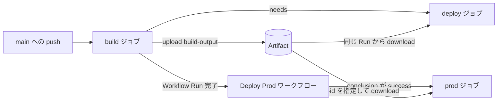

## はじめに

GitHub Actions で CI/CD を組んでいると、「ビルドしたものを別のジョブで使いたい」「あるワークフローの成果物を、別のワークフローからデプロイしたい」といった場面がよく出てきます。ただ、ジョブは基本的に別々のランナーで動くので、`build` で作ったファイルを `deploy` からそのまま参照する、というわけにはいきません。

このあたりを支えるのが Artifact（`actions/upload-artifact` / `actions/download-artifact`）です。この記事では、Artifact の基本から、同一ワークフロー内の受け渡し、別ワークフローからの取得、そして「成功したときだけ本番デプロイする」といった条件づけまで、自分の理解を整理するためにまとめた検証メモです。特定のリポジトリ構成に依存しない、一般的なナレッジとして書いています。

なお、各キーワードの正確な仕様は公式ドキュメントを参照してください（[成果物を使用したワークフロー データの保存と共有](https://docs.github.com/ja/actions/how-tos/manage-workflow-runs/store-and-share-data)）。

## Artifact の基本

`actions/upload-artifact` は、ランナー上にある `path` のファイルを GitHub Actions のストレージへアップロードし、その Workflow Run に紐づけます。パス情報だけを保存するわけではなく、ファイルの実体がアップロードされる、というのがまず押さえどころです。

```yaml
- uses: actions/upload-artifact@v4
  with:
    name: build-output
    path: dist/
```

- `name` は GitHub Actions 上で識別する Artifact 名です。省略すると `artifact` になります。
- `path` はアップロード元のファイルまたはディレクトリです。
- ジョブのランナーとワークスペースは、ジョブ間で共有されません。後続ジョブでファイルを使うには、Artifact としてアップロード・ダウンロードする必要があります。
- Artifact は Workflow Run に紐づくため、別の Workflow Run から取得するときは対象の Run ID が必要になります。

「ランナーはジョブごとに使い捨て」という前提を意識しておくと、なぜ Artifact が必要になるのかが腑に落ちやすいです。

## 同一ワークフロー内での受け渡し

まずは一番シンプルな、同じワークフロー内でのジョブ間受け渡しです。`build` ジョブが `dist` をアップロードし、`deploy` ジョブがダウンロードする、という流れを考えます。

```yaml
jobs:
  build:
    runs-on: ubuntu-latest
    steps:
      - uses: actions/checkout@v4
      - run: npm ci && npm run build
      - uses: actions/upload-artifact@v4
        with:
          name: build-output
          path: dist

  deploy:
    needs: build
    runs-on: ubuntu-latest
    steps:
      - uses: actions/download-artifact@v4
        with:
          name: build-output
          path: website
```

ポイントは `needs: build` です。これがあることで、`deploy` は `build` の正常終了後に開始します。もし `needs` を書かないと、両ジョブは原則として並列で走るため、ダウンロードしようとした時点でまだ Artifact が存在しない、という事故につながります。また、依存先の `build` が失敗した場合、通常 `deploy` はスキップされます。

`upload-artifact` の `name` と `download-artifact` の `name` を一致させることで、どの Artifact を取ってくるかを指定しています。

## 別ワークフローからの受け渡し

次に、少し踏み込んで「別のワークフローの完了をトリガーに、その成果物を取得する」パターンです。ビルドとデプロイをワークフロー単位で分けたいときなどに使います。

これには `workflow_run` イベントを使います。

```yaml
on:
  workflow_run:
    workflows: ["Build and Deploy"]
    types: [completed]
```

ここで `workflows` に書く値は、**ファイル名ではなく、対象ワークフローのトップレベルの `name`** です。つまり、監視したいワークフロー側にこう書いてあるなら、

```yaml
name: Build and Deploy
```

`workflow_run` 側もこの `Build and Deploy` という文字列で一致させる必要があります。ファイル名（`build-deploy.yml` など）ではない点が地味にハマりどころです。

起動後は、トリガー元となった Workflow Run の情報を `github.event.workflow_run` から参照できます。

```yaml
${{ github.event.workflow_run.id }}
${{ github.event.workflow_run.conclusion }}
```

そして、別の Workflow Run が生成した Artifact を取得するには、対象の Run ID と GitHub Token を明示します。

```yaml
- uses: actions/download-artifact@v4
  with:
    name: build-output
    path: website
    run-id: ${{ github.event.workflow_run.id }}
    github-token: ${{ secrets.GITHUB_TOKEN }}
```

同一ワークフロー内のダウンロードと違い、`run-id` と `github-token` を指定しているのがポイントです。Artifact は Workflow Run に紐づいているので、「どの Run のものか」を明示的に教えてあげる必要があるわけです。また、この取得には `actions: read` 権限が必要になります。

## 成功時だけ本番デプロイする

`workflow_run` を使うときにもう一つ注意したいのが、`types: [completed]` の挙動です。これは対象ワークフローが**成功したときだけでなく、失敗・キャンセルなどで「完了」したときにも発火**します。

つまり「ビルドが失敗したのに、それをトリガーに本番デプロイが走ってしまった」という事態が起こり得ます。これを防ぐために、デプロイジョブ側で条件を付けます。

```yaml
jobs:
  deploy-prod:
    if: github.event.workflow_run.conclusion == 'success'
    runs-on: ubuntu-latest
    steps:
      - run: echo "本番デプロイを実行"
```

`conclusion` が `success` のときだけデプロイへ進む、という条件です。`completed`（イベントが発火する条件）と `success`（実際に成功したか）を分けて考えると分かりやすいです。

なお、デプロイステップ自体は環境によって置き換わります。たとえば Azure App Service なら、Azure CLI の `az webapp deploy --type zip ...` を使ったり、公式の `azure/webapps-deploy` Action を使ったりします。いずれの場合も、その前に `azure/login` などで認証し、認証情報は GitHub Secrets や OIDC 経由で渡します。

## 複数ワークフローを指定するときの注意

`workflow_run` の監視対象は、複数指定することもできます。

```yaml
on:
  workflow_run:
    workflows:
      - Build Frontend
      - Build Backend
    types: [completed]
```

ここで勘違いしやすいのが、これが **OR 条件**である点です。`Build Frontend` と `Build Backend` の**どちらか一方**が完了するたびに後続ワークフローが起動します。「両方の完了を待ってから動く」という AND 条件にはなりません。

`workflow_run.workflows` には、ネイティブな AND 待機の仕組みがありません。両方の処理を待ちたい場合は、可能であれば**同一ワークフロー内の複数ジョブとして定義し、後続ジョブからまとめて依存させる**設計が一番シンプルです。

```yaml
jobs:
  deploy:
    needs:
      - build-frontend
      - build-backend
```

`needs` を配列で書くと、列挙したジョブがすべて成功してから `deploy` が動きます。これが素直な AND 待機です。

どうしてもワークフローを分離したまま AND 条件を実現したい場合は、GitHub API などを使って各ワークフローの実行状態を確認する追加ロジックを自前で組む必要があります。ここは複雑になりがちなので、まずは「同一ワークフロー内のジョブに寄せられないか」を検討するのがおすすめです。

## 全体像

ここまでの要素を一枚の図にまとめると、こんなイメージです。



## まとめ

GitHub Actions で「どこに何を書くか」を意識すると、ファイルの受け渡しはかなり読み解きやすくなります。最後に使い分けを整理しておきます。

- **ファイル本体の受け渡し**: `upload-artifact` と `download-artifact`。ランナーはジョブごとに使い捨てなので、実体を Artifact に載せて運ぶ。
- **同一ワークフロー内のジョブ間依存**: `needs`。実行順序を決めつつ、依存先の成果物を確実に受け取れる。
- **別ワークフローの完了通知**: `workflow_run`。`workflows` にはファイル名ではなくワークフローの `name` を書く。別 Run の Artifact 取得には `run-id` と `github-token` が要る。
- **完了と成功の区別**: `types: [completed]` は失敗時にも発火する。本番デプロイは `conclusion == 'success'` で絞る。
- **複数ワークフロー監視は OR**: AND 待機したいなら、同一ワークフロー内の複数ジョブ + `needs` の配列に寄せるのが素直。

このあたりを押さえておくと、CI/CD の各ジョブがどうつながっているかを、あとから追いやすくなります。

