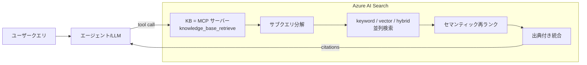

# 趣旨

Foundry IQ のナレッジベース（Knowledge Base, 以下 KB）は、実体としては **Azure AI Search が提供する MCP サーバー**として公開される、という構造になっています。本記事では「KB が MCP ツールとしてどう見えるのか」から「エージェント（LLM）のツール選択（呼び出し）がどう決まるのか」までを段階的に整理します。とくに、複数 KB を並べたときにどう見分けさせるか、そして agent instructions は結局どこに効くのか、という実務上の勘所を押さえていきます。

> 参考（一次情報）
> - [Foundry IQ とは / Information retrieval](https://learn.microsoft.com/azure/architecture/ai-ml/guide/rag/rag-information-retrieval#extend-retrieval-by-using-foundry-iq-and-work-iq)
> - [Connect a Foundry IQ knowledge base to Foundry Agent Service](https://learn.microsoft.com/azure/foundry/agents/how-to/foundry-iq-connect)
> - [Query a knowledge base using the retrieve action or MCP endpoint](https://learn.microsoft.com/azure/search/agentic-retrieval-how-to-retrieve#call-the-mcp-endpoint)
> - [Create a knowledge base in Azure AI Search](https://learn.microsoft.com/azure/search/agentic-retrieval-how-to-create-knowledge-base)

---

## 先に結論

細部に入る前に、本記事で言いたいことを 3 点に絞っておきます。

まず、**KB は「AI Search が提供する MCP サーバー」としてシンプルに見えます**。Foundry Agent から見ても、外部の MCP クライアントから見ても同じであり、内外で挙動は変わりません。

次に、**ツールを呼ぶかどうか・どれを呼ぶかは、呼び出し元の LLM が name / description をもとに判断します**。ただし KB のツール名は全 KB 共通で `knowledge_base_retrieve` に固定されているため、KB 同士の見分けは実質 description（＋ server_label）が担うことになります。

最後に、**agent instructions が効くのは Foundry IQ 固有の特別な仕組みではありません**。単に「KB をちゃんと使え」と呼び出し元 LLM に指示しているだけで、KB 側に何かフックがかかっているわけではありません。あくまで呼び出し元の挙動制御です。

この 3 点を、一般的な MCP ツールと対比すると次のように整理できます。

| 観点 | 一般 MCP ツール | KB（Foundry IQ） |
| --- | --- | --- |
| ツール名 | 固有 → **効く** | `knowledge_base_retrieve` 固定 → **効かない** |
| description | 効く | **効く（見分けの主役）** |
| 呼ぶ / 呼ばないの精度 | instructions で制御 | instructions で制御（同じ） |

---

## 1. Foundry IQ とは何か

Foundry IQ の実体は、**Azure AI Search 上に用意された「マネージドな agentic retrieval 実装」**であり、Foundry 専用の閉じたロジックではありません。取り込み（chunk 化・埋め込み生成・権限適用）を自動化し、その上に検索オーケストレーション（クエリ分解 → 並列検索 → セマンティック再ランク → 出典付き統合）を載せたもの、と捉えると分かりやすいでしょう。

そして、**各ナレッジベース（KB）が「単独の MCP サーバー」として公開されます**。Foundry Agent Service は、その MCP サーバーに接続する「利用者の 1 つ」にすぎません。同じエンドポイントは GitHub Copilot / Claude / Cursor といった他の MCP クライアントからも呼べます。

一言でいえば、Foundry IQ とは **「Azure AI Search が提供する agentic 検索を、MCP サーバーとして公開したもの」**です。Foundry からは、その MCP ツールに接続して使っているだけ、ということになります。



---

## 2. MCP サーバーとしての公開形

各 KB は次の MCP エンドポイントを持ちます。

```text
https://<search-service>.search.windows.net/knowledgebases/<kb-name>/mcp?api-version=<version>
```

公開されるツールは**固定名で 1 つだけ**の `knowledge_base_retrieve` です。呼ばれると内部で以下を実行し、出典付きの統合レスポンスを返します。

1. ユーザークエリをサブクエリに分解
2. keyword / vector / hybrid で並列検索
3. セマンティック再ランク
4. 結果を統合し、source 参照付きで返す

---

## 3. いつ Foundry IQ がキックされるか

ここで注意したいのは、Foundry IQ は常時走る前処理ではない、という点です。あくまで **エージェント（LLM）が `knowledge_base_retrieve` のツール呼び出しを選択したとき**に初めて起動します。つまり、リクエストのたびに必ず検索が走るわけではありません。

では「呼ぶ / 呼ばない」を左右するのは何かというと、主要因は **agent instructions（システムプロンプト）**です。ドキュメントで推奨されているテンプレートも、「KB ツールを必ず使え」と明示することで**呼び出し率を上げる**ことを狙っています。

```text
Use the knowledge base tool to answer user questions.
If the knowledge base doesn't contain the answer, respond with "I don't know".
When you use information from the knowledge base, include citations to the retrieved sources.
```

したがって、「agent instructions に書くと Foundry Agent からの呼び出し精度が上がる」という直感は正しいと言えます。効いているのは KB 側ではなく、あくまで呼び出し元 LLM の判断に対してです。

---

## 4. ツール選択のメカニズム

LLM のツール選択は **description 単独ではありません**。次を合わせて判断します。

```text
ツールを呼ぶか / どれを呼ぶか
  = LLM の推論(
        agent instructions
      + 各ツールの name / description（MCP tools/list 由来）
      + input schema
      + ユーザー発話・会話履歴
    )
```

2 つの判断を分けて考えると整理しやすくなります。

| 判断 | 主に効くもの |
| --- | --- |
| そもそも呼ぶべきか（呼ぶ / 呼ばない） | **agent instructions が支配的** |
| 複数ツール／複数 KB のどれを呼ぶか | 各ツールの **name / description** |

---

## 5. KB の設定値と役割

KB のスキーマ（抜粋）は次のとおりです。

```json
{
  "name": "my-kb",
  "description": "この KB が何を答えられるかの自然言語説明",
  "retrievalInstructions": "KB 内部で複数 knowledge source をどう振り分けるか",
  "answerInstructions": "回答の整形指示",
  "outputMode": "answerSynthesis",
  "knowledgeSources": [ ],
  "models": [ ],
  "retrievalReasoningEffort": { "kind": "low" }
}
```

| フィールド | 役割 | ツール選択への影響 |
| --- | --- | --- |
| `name` | KB 識別子（エンドポイント URL に入る） | ツール名は固定 `knowledge_base_retrieve` |
| **`description`** | KB の自然言語説明（tool-facing） | **複数 KB の見分けに効く** |
| `retrievalInstructions` | KB 内部の source ルーティング | 外部ツール選択には出ない（内部用） |
| `answerInstructions` | 回答生成の整形 | 選択には無関係 |

:::message
「tools/list の description に KB の `description` がそのまま入る」と逐語的に明記した公式記述は確認できていません。ただしスキーマ上、外部向けの自然言語説明は `description` のみで、これが tool-facing の説明として機能する位置づけです。
:::

---

## 6. 複数 KB を使う場合

複数の KB を 1 つのエージェントから使わせるケースを考えます。ここでポイントになるのは、**各 KB はそれぞれ独立した MCP サーバー**であり、エンドポイントも別々だということです。当然、**各 KB は自分自身の `description` を持ちます**。

それにもかかわらず、**ツール名は全 KB 共通で `knowledge_base_retrieve` に固定されています**。ここが盲点で、ツール名だけを見ても KB の区別はつきません。

| MCP サーバー | server_label（任意で付与） | ツール名（固定） | description |
| --- | --- | --- | --- |
| hr-policy-kb | `hr-kb` | `knowledge_base_retrieve` | KB1 の説明 |
| it-faq-kb | `it-kb` | `knowledge_base_retrieve` | KB2 の説明 |
| product-kb | `product-kb` | `knowledge_base_retrieve` | KB3 の説明 |

Python（Foundry）での登録イメージは次のようになります。

```python
from azure.ai.projects.models import PromptAgentDefinition, MCPTool

mcp_hr = MCPTool(
    server_label="hr-kb",
    server_url="{search}/knowledgebases/hr-policy-kb/mcp?api-version=2026-05-01-preview",
    allowed_tools=["knowledge_base_retrieve"],
    project_connection_id="hr-conn",
    require_approval="never",
)
mcp_it = MCPTool(
    server_label="it-kb",
    server_url="{search}/knowledgebases/it-faq-kb/mcp?api-version=2026-05-01-preview",
    allowed_tools=["knowledge_base_retrieve"],
    project_connection_id="it-conn",
    require_approval="never",
)

agent = project_client.agents.create_version(
    agent_name=agent_name,
    definition=PromptAgentDefinition(
        model=agent_model,
        instructions=instructions,
        tools=[mcp_hr, mcp_it],   # 別サーバーとして並ぶ
    ),
)
```

ツール名が全部同じなので、複数 KB の見分けは **description（＋ server_label ＋ instructions）** で行わせます。

---

## 7. 一般 MCP ツールと混在する場合

一般 MCP ツールは **name も description も個別に意味を持つ**ので、LLM は両方を読みます。

| ツール | name | description | 見分けの主軸 |
| --- | --- | --- | --- |
| 天気 | `get_weather` | "Get current weather for a city" | name も description も効く |
| 送金 | `send_payment` | "Transfer money between accounts" | name だけでほぼ判別可能 |
| 社内 KB | `knowledge_base_retrieve` | KB の description | name 共通 → **description 頼み** |

混在環境では**二層構造**で判断されます。

- **一般ツール**：固有の name で大枠を絞り、description で詰める
- **KB 群**：name が共通なので description / server_label / instructions で見分ける

---

## 8. 実務上のまとめ

1. **呼び出し率・精度を上げたい** → まず **agent instructions** に「この種の質問では必ず KB を使え」と明示します（最優先）。
2. **複数 KB / 一般ツールを見分けさせたい** → 各ツールの **description を具体的に**し、KB は **server_label** も意味のある名前にします。
3. **一般ツールは name を役割が伝わる命名**にすると選択が安定します（例：`search_hr_docs`）。
4. **KB 内部の source 振り分け**が必要なときだけ `retrievalInstructions` を使います。

### 優先度（ノブの効き順）

| 順位 | ノブ | 主な効果 |
| --- | --- | --- |
| 1 | agent instructions | 呼ぶ / 呼ばないの精度（支配的） |
| 2 | 各ツールの description（＋ name） | 複数候補からの選択 |
| 3 | server_label | 人間・ログ上の識別、選択補助 |
| 4 | retrievalInstructions | KB 内部の source ルーティング |
