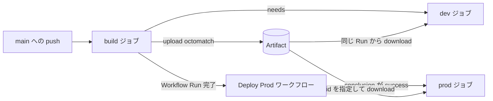

# GitHub Actions の Artifact とワークフロー連携

この文書は、このリポジトリについて複数の会話セッションで確認した内容をまとめた学習メモです。

## Artifact の基本

`actions/upload-artifact` は、ランナー上にある `path` のファイルを GitHub Actions のストレージへアップロードし、その Workflow Run に紐づけます。パス情報だけを保存するわけではありません。

```yaml
- uses: actions/upload-artifact@v7
  with:
    name: test-coverage-report
    path: coverage/
```

- `name` は GitHub Actions 上で識別する Artifact 名です。省略時は `artifact` になります。
- `path` はアップロード元のファイルまたはディレクトリです。
- ジョブのランナーとワークスペースはジョブ間で共有されません。後続ジョブでファイルを使うには、Artifact としてアップロード・ダウンロードする必要があります。
- Artifact は Workflow Run に紐づくため、別の Workflow Run から取得するときは対象の Run ID が必要です。

## 同一ワークフロー内での受け渡し

現在の `build-deploy.yml` では、`build` ジョブが `dist` を `octomatch` という名前でアップロードし、`dev` ジョブがダウンロードしています。

```yaml
jobs:
  build:
    steps:
      - run: npm run build
      - uses: actions/upload-artifact@v7
        with:
          name: octomatch
          path: dist

  dev:
    needs: build
    steps:
      - uses: actions/download-artifact@v8
        with:
          name: octomatch
          path: website
```

`needs: build` により、`dev` は `build` の正常終了後に開始します。これがない場合、両ジョブは原則として並列実行されるため、ダウンロード時点で Artifact がまだ存在しない可能性があります。また、依存先の `build` が失敗すると、通常 `dev` はスキップされます。

## デプロイジョブの役割

現在のデプロイステップは、取得したファイルを `tree` で表示するデモです。本番運用では、ここを実際のデプロイ処理に置き換えます。

Azure App Service の場合は、例えば次のいずれかを利用します。

- Azure CLI の `az webapp deploy --type zip ...`
- 公式の `azure/webapps-deploy` Action

その前に `azure/login` などで認証し、認証情報は GitHub Secrets や OIDC から渡します。

## 別ワークフローからの受け渡し

`deploy-prod.yml` は、`Build and Deploy` ワークフローの完了を `workflow_run` で監視しています。

```yaml
on:
  workflow_run:
    workflows: ["Build and Deploy"]
    types: [completed]
```

`workflows` に書く値はファイル名ではなく、対象ワークフローのトップレベルの `name` です。ここでは `build-deploy.yml` の次の値と一致します。

```yaml
name: Build and Deploy
```

起動後は、対象となった Workflow Run の情報を `github.event.workflow_run` から参照できます。

```yaml
${{ github.event.workflow_run.id }}
${{ github.event.workflow_run.conclusion }}
```

別 Workflow Run の Artifact を取得するため、現在の設定では対象 Run ID と GitHub Token を明示しています。

```yaml
- uses: actions/download-artifact@v8
  with:
    name: octomatch
    path: website
    run-id: ${{ github.event.workflow_run.id }}
    github-token: ${{ secrets.GITHUB_TOKEN }}
```

この取得には `actions: read` 権限が必要です。

## 成功時だけ本番デプロイする条件

`workflow_run` の `types: [completed]` は、対象ワークフローが成功した場合だけでなく、失敗・キャンセルなどで完了した場合にも発火します。そのため、`prod` ジョブには次の条件があります。

```yaml
if: github.event.workflow_run.conclusion == 'success'
```

これにより、`Build and Deploy` が成功したときだけ本番デプロイへ進みます。

## 複数ワークフローの指定

監視対象は複数指定できます。

```yaml
on:
  workflow_run:
    workflows:
      - Build Frontend
      - Build Backend
    types: [completed]
```

この指定は OR 条件です。どちらか一方が完了するたびに後続ワークフローが起動し、両方の完了を待つ AND 条件にはなりません。

`workflow_run.workflows` にはネイティブな AND 待機がありません。両方の処理を待つ必要がある場合は、可能なら同一ワークフロー内の複数ジョブとして定義し、後続ジョブから次のようにまとめて依存する設計が単純です。

```yaml
jobs:
  deploy:
    needs:
      - build-frontend
      - build-backend
```

ワークフローを分離したまま AND 条件を実現する場合は、GitHub API などを使って各ワークフローの実行状態を確認する追加ロジックが必要です。

## 現在の処理フロー



要点は、同一ワークフロー内のジョブ間依存には `needs`、別ワークフローの完了通知には `workflow_run`、ファイル本体の受け渡しには `upload-artifact` と `download-artifact` を使い分けることです。