# Azure Migrate エージェントベース移行 - フェーズ別アーキテクチャ図

---

## 全体構成（最終形）

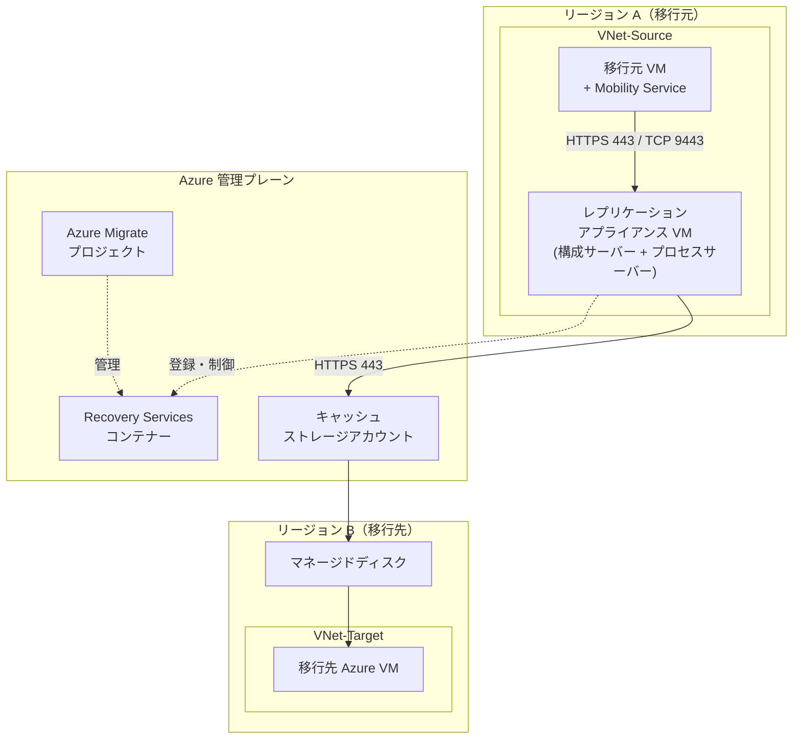

---

## 補足: テナント間移行の場合の検出設定

Azure Migrate は基本的に **オンプレミス → Azure** の移行を想定したツールだが、**Azure VM → 別テナントの Azure** への移行にも利用可能。この場合、Azure VM を **「物理サーバー」として扱う**。

### Discovery（検出）の選択

| 設定項目 | 選択値 |
|---|---|
| Discovery 方法 | **Using appliance → For Azure** |
| Are your servers virtualized? | **Physical or other (AWS, GCP, Xen, etc.)** |

**理由:** Azure VM は Hyper-V ベースの仮想化上で動作しているが、別テナントのハイパーバイザーに直接アクセスする手段がないため、VMware / Hyper-V のアプライアンスは使えない。公式ドキュメントでも、パブリッククラウド上の VM は「物理サーバーとして扱う」ことが推奨されている。

### テナント間移行の代替アプローチ

| 方法 | 概要 |
|---|---|
| **Azure Backup + Restore** | 元テナントで VM をバックアップ → サイドカーサブスクリプション経由で新テナントにリストア |
| **サブスクリプション移動** | サイドカーサブスクリプションを元テナントに作成 → データを複製 → サブスクリプションごと新テナントに移動 |
| **ARM/Bicep テンプレート** | 構成をエクスポートし、新テナントで再デプロイ |

> 📖 参考: [テナント間クラウドワークロード移行ガイド (Microsoft Architecture Center)](https://learn.microsoft.com/azure/architecture/solution-ideas/articles/migrate-cloud-workloads-across-security-tenants)

---

## Phase 1: Azure の準備

**触る箇所**: Azure 管理プレーン + 移行先リージョン

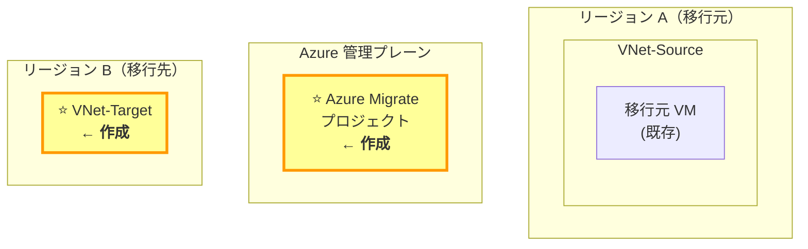

**やること:**
1. Azure Migrate プロジェクトを作成
2. 権限の確認（共同作成者/所有者、アプリケーション開発者ロール）
3. 移行先リージョンに VNet / サブネット を作成

---

## Phase 2: レプリケーションアプライアンスの構築

**触る箇所**: 移行元 VNet + Azure 管理プレーン

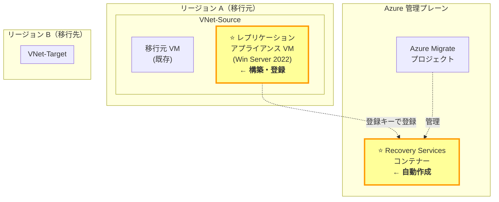

**やること:**
1. 移行元 VNet に Windows Server 2022 VM を作成（8 vCPU / 16 GB RAM / 600 GB ディスク）
2. NSG で HTTPS 443 / TCP 9443 を許可
3. Azure Migrate ポータルから「検出」→ リソース作成（Recovery Services コンテナーが自動作成）
4. インストーラー + 登録キーをダウンロード → アプライアンス VM にインストール
5. Configuration Manager で登録完了

> **⚠️ トラブルシューティング: アプライアンス登録時の MFA エラー**
>
> アプライアンス登録時に以下のエラーが出る場合がある:
>
> ```
> Resource 'Servers-Discovery-ServerDiscovery' was disallowed by Azure:
> You are receiving this error because you tried to create, update or delete
> Azure resources without authenticating through MFA.
> ```
>
> **原因:** Azure Migrate のアプライアンス登録には **MFA 認証済みセッション**が必要。ログイン自体は成功しても、MFA を経由していないと Azure リソースの作成が拒否される。
>
> **対処:**
> 1. テナントで MFA が有効か確認（Entra ID → Security defaults or Conditional Access or Per-user MFA）
> 2. **Conditional Access ポリシーが存在する場合**、Security defaults は有効化できない（排他的）
>    - Entra ID Premium がない場合は **Per-user MFA**（Identity → Users → All users → Per-user MFA）で有効化
> 3. Configuration Manager で **Logout → 再 Login** し、MFA プロンプトに応答してから **Retry**
> 4. アプライアンス名は登録後に変更不可。キーの再生成が必要な場合は**新しいアプライアンス名**で生成する
>
> **補足:** 既存の Conditional Access ポリシー（例: "Multifactor authentication for Microsoft partners and vendors"）が MFA セッションをキャッシュしている場合、再ログインだけで通ることもある。

> **📝 コラム: レプリケーションアプライアンスの役割**
>
> レプリケーションアプライアンスは、移行元環境と Azure の間の**ブリッジ（橋渡し）**として機能する。内部には 2 つのコンポーネントがある。
>
> | コンポーネント | 役割 | ポート |
> |---|---|---|
> | **構成サーバー** | Azure との管理通信・レプリケーションの**オーケストレーション（指揮・調整）** | HTTPS 443（送受信） |
> | **プロセスサーバー** | 移行元 VM からデータを受信し、**ローカルにバッファリング → 圧縮 → 暗号化**して Azure に送信 | HTTPS 9443（受信）/ HTTPS 443（送信） |
>
> ```
> 移行元 VM (Mobility Service)
>   ──[HTTPS 9443]──▶ プロセスサーバー（バッファリング・圧縮・暗号化）
>     ──[HTTPS 443]──▶ キャッシュストレージ（ログとして着地）
>       ──[Azure 内部処理]──▶ マネージドディスク（レプリカディスク）
> ```
>
> 移行対象が 200 台超や日次変更率 2 TB 超の場合は、**スケールアウトプロセスサーバー**を追加デプロイできる。

> **📝 トラブルシューティング: アプライアンス登録時の MFA エラー**
>
> Azure Migrate アプライアンスを Azure に登録する際、Azure アカウントで **MFA（多要素認証）が必須**。MFA が有効化されていないと、以下のエラーが発生する場合がある:
>
> ```
> You are receiving this error because you tried to create, update or delete
> Azure resources without authenticating through MFA
> ```
>
> **解決策:**
> 1. Azure アカウントで MFA を有効化する（Microsoft Entra ID → ユーザー → 認証方法）
> 2. 新しい登録キーを生成する（既存の名前でも可）
> 3. ApplicationConfigurationManager に新しいキーを入力して再試行
>
> キーは Azure Migrate ポータルから何度でも再生成可能。入力後に "Verified" と表示されれば登録成功。

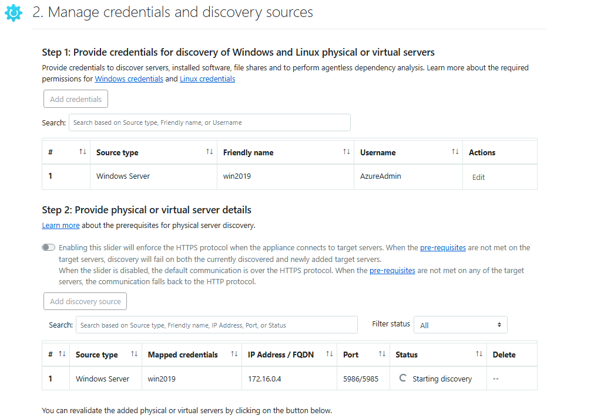

検出できるとこんな感じ
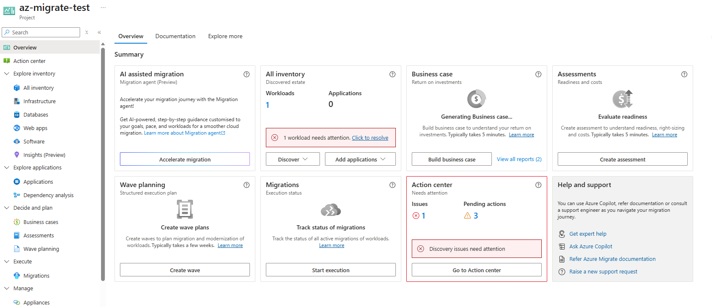
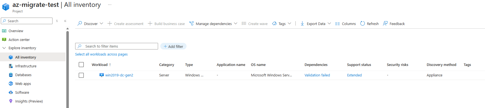

エラーを解消する（IIS が認識された）
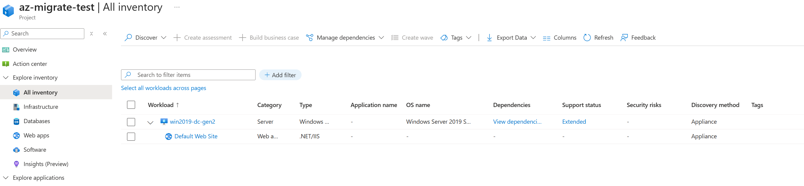

> **📝 コラム: Discovery 完了と移行開始のタイミング**
>
> Discovery（検出）とレプリケーション・移行は**独立したプロセス**であり、Discovery のエラーが移行をブロックすることはない。
>
> | 項目 | Discovery（検出） | レプリケーション・移行 |
> |---|---|---|
> | **目的** | インベントリ収集・アセスメント（評価） | 実際のデータ移行 |
> | **使うコンポーネント** | アプライアンス（WinRM 5985/5986 / SSH 22） | Mobility Service + プロセスサーバー |
> | **移行への依存** | 必須ではない | 独立して動作 |
>
> ただし、**本番移行では Discovery が正常に完了してから移行計画を立てるべき**。理由:
> - アセスメント結果（VM サイズ、ディスク種類の推奨）は Discovery データに依存する
> - アプリ依存関係の把握も Discovery で行われる
> - Discovery エラーが残ったまま移行すると、移行先 VM のスペックが不適切になるリスクがある
>
> **POC ではスキップ可、本番では Discovery 完了を待つ**、が実務的な判断。

> **📝 コラム: アセスメント（Assessment）の必要性**
>
> Discovery 完了後、レプリケーションに進む前に**アセスメント**を実施するかどうかの判断が必要。
>
> 公式ドキュメントの記述:
> > *"We recommend that you assess machines before migration, but you don't have to."*
>
> | 役割 | 内容 |
> |---|---|
> | **Azure 対応状況の判定** | Ready / Conditionally Ready / Not Ready の判定、移行ブロッカーの検出 |
> | **VM サイズの推奨** | パフォーマンスデータに基づく最適な Azure VM SKU の提案 |
> | **ディスクタイプの推奨** | Standard HDD / Standard SSD / Premium の推奨 |
> | **コスト見積もり** | 月額コスト（RI、Azure Hybrid Benefit 考慮）の試算 |
>
> レプリケーション設定時に「**Import migration settings from an Azure Migrate assessment?**」と聞かれる:
> - **Yes** → アセスメント結果の推奨値（VM サイズ、ディスクタイプ）が自動適用
> - **No** → 手動でサイズやディスクを指定（アセスメントなしでも移行可能）
>
> | シナリオ | アセスメント |
> |---|---|
> | **POC・少数台の検証** | スキップ可（手動で VM サイズを指定） |
> | **本番移行** | 必ず実施（パフォーマンスデータ収集のため最低 1 日待機推奨） |

---

## Phase 2b: アセスメント（評価）

**触る箇所**: Azure Migrate ポータル（Azure 管理プレーン）

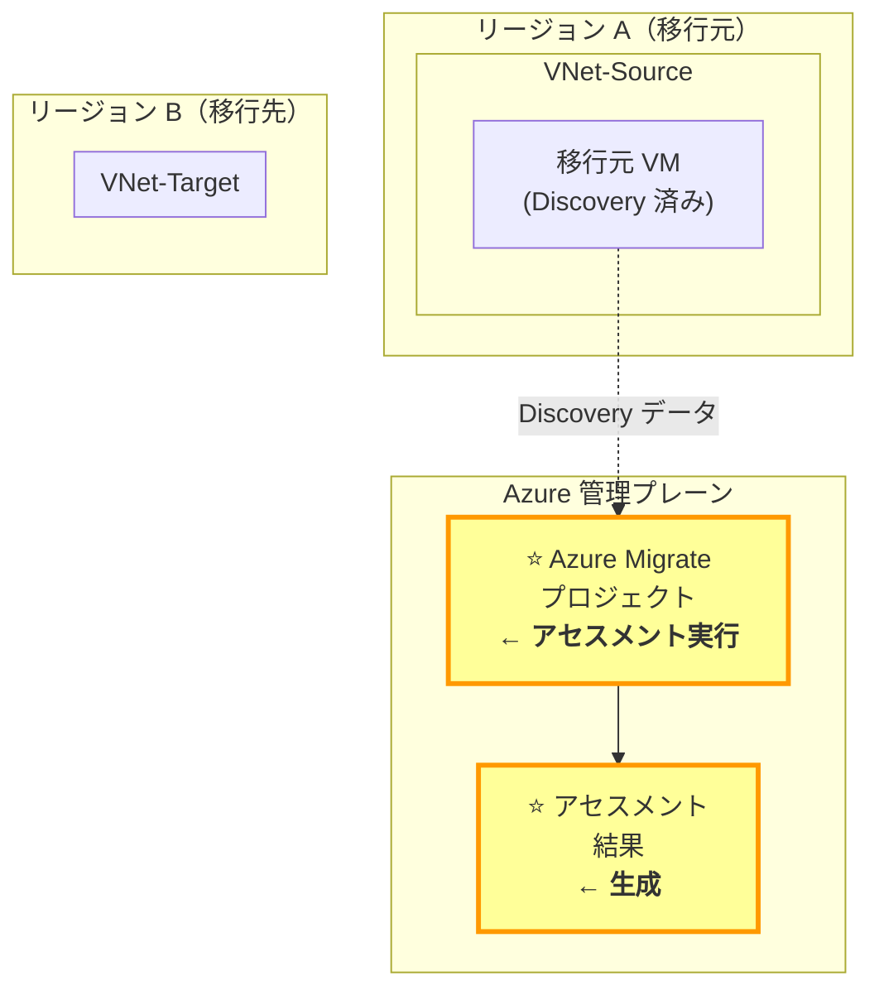

**やること:**
1. Azure Migrate ポータルで「評価」を選択
2. 評価グループを作成 + 評価を追加
3. 評価プロパティを設定（Azure VM のサイズ、ディスクタイプ、可用性セット等）
4. 評価を実行し、結果を確認
5. 必要に応じてパフォーマンスベースのサイズ変更を調整

アセスメント結果のサンプル
VM に移行するべし、となっている
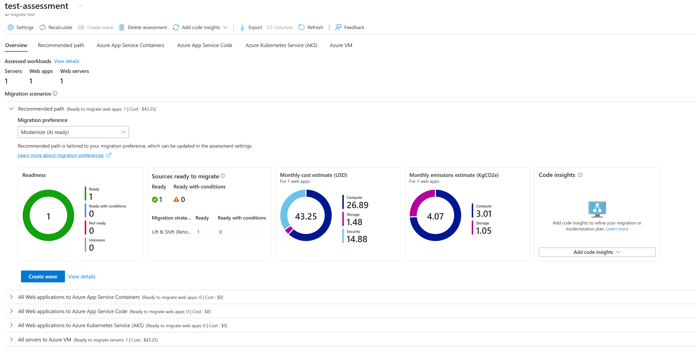
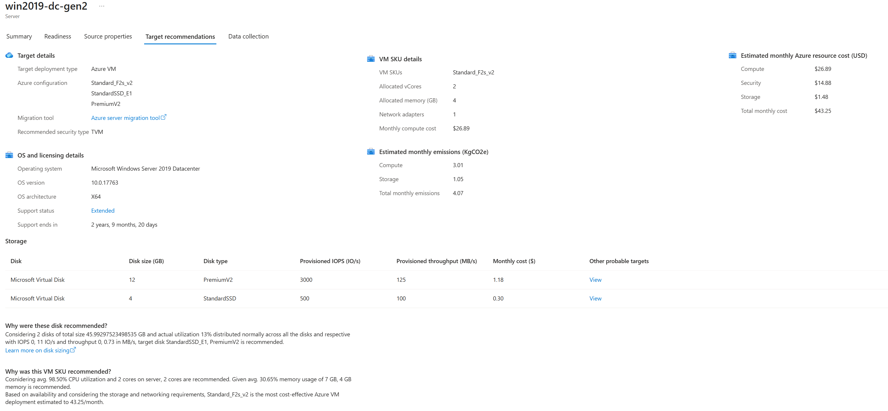

> **📝 コラム: 評価のサイズ基準**
>
> | 設定項目 | 推奨 | 備考 |
> |---|---|---|
> | **Azure VM のサイズ** | パフォーマンスベース | 実際の CPU/メモリ使用に基づく推奨 |
> | **ディスクタイプ** | パフォーマンスベース | ディスク I/O に基づく推奨 |
> | **可用性セット** | 単一 VM または可用性セット | アプリケーション要件による |
> | **Azure Hybrid Benefit** | 有効化 | Windows ライセンス持有の場合はコスト削減 |
> | **予約インスタンス** | 検討 | 本番環境なら RI 検討 |
>
> **パフォーマンスデータの収集期間:** 最低 **1 日** 以上推奨。短すぎると正確な推奨にならない。

> **📝 コラム: アセスメント結果の活用**
>
> レプリケーション設定時にアセスメント結果をインポートできる:
>
> - **Yes を選択** → VM サイズ、ディスクタイプが自動適用される
> - **No を選択** → 手動で指定（Assessments なしでも移行は可能）
>
> POC 検証では「手動指定」、本番移行では「インポート推奨」。

---

## Phase 3: 移行元 VM の準備

**触る箇所**: 移行元 VM

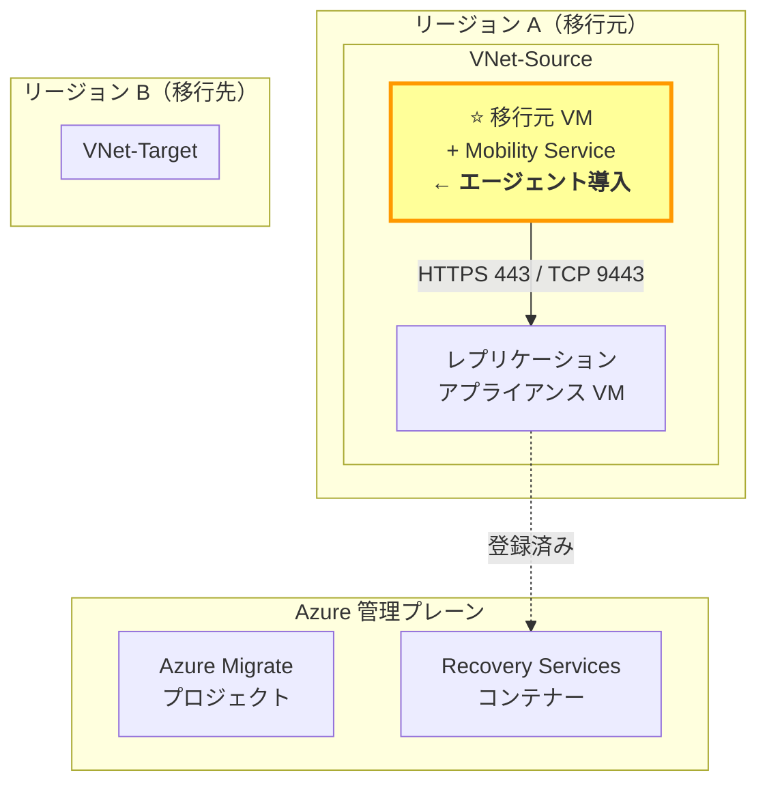

**やること:**
1. 移行元 VM に Mobility Service をインストール（プッシュ or 手動）
2. Windows: `LocalAccountTokenFilterPolicy` レジストリ設定（ローカルアカウント使用時）
3. Linux: root アカウント準備、Azure Linux Agent 確認
4. OS 固有の事前変更（SAN ポリシー、initramfs 等）


Migration のペインから、マイグレーションを開始できる
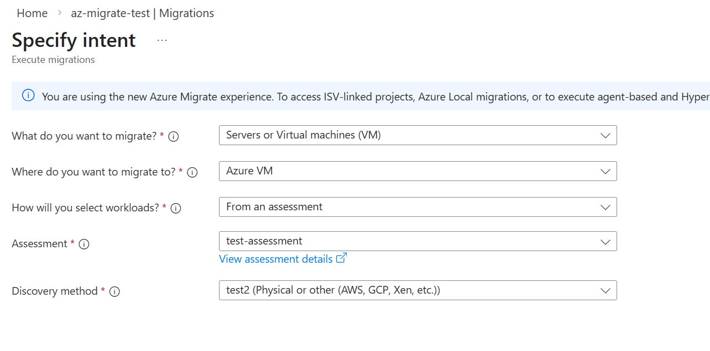


---

## Phase 4: レプリケーションの開始

**触る箇所**: Azure Migrate ポータル（レプリケーション設定）+ キャッシュストレージ

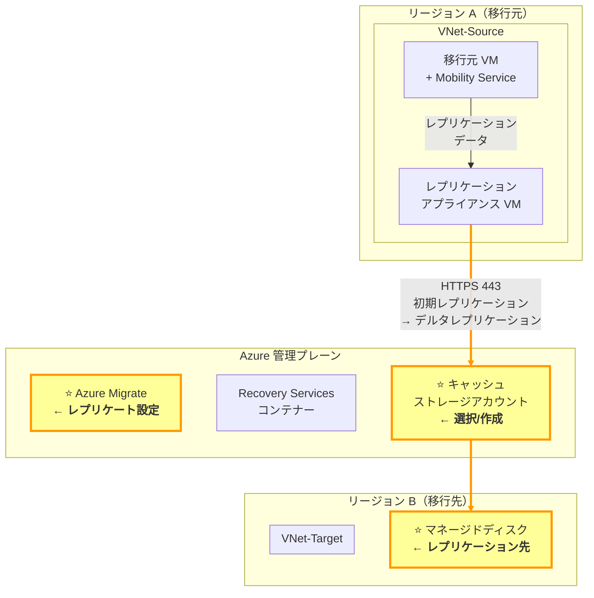

**やること:**
1. Azure Migrate → 「レプリケート」からソース・ターゲット設定
2. 移行対象 VM、移行先 VNet、キャッシュストレージを指定
3. ディスクタイプ、可用性オプション、暗号化を構成
4. レプリケーション開始（初期レプリケーション → デルタレプリケーション）

---

## Phase 5: テスト移行

**触る箇所**: 移行先リージョンにテスト VM が作成される

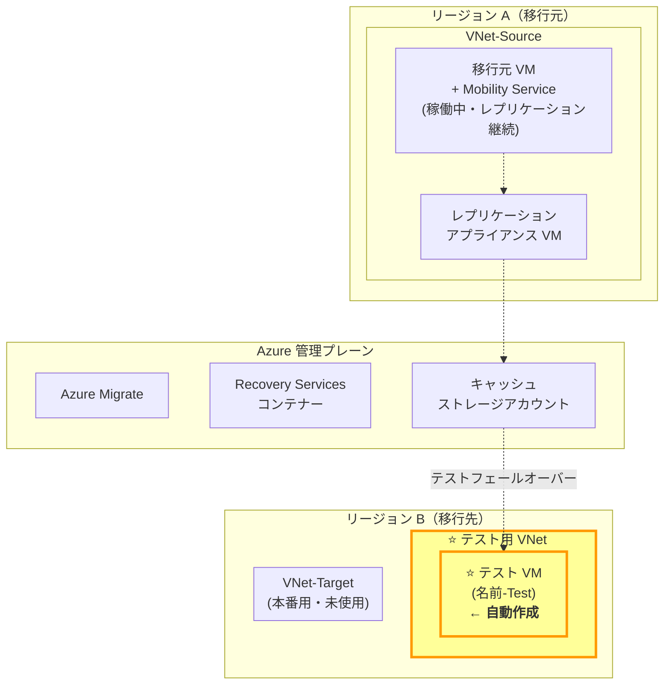

**やること:**
1. 「テスト移行」を実行（テスト用 VNet を指定）
2. テスト VM（`-Test` サフィックス）が移行先リージョンに作成される
3. アプリケーション動作確認・接続テスト
4. テスト完了後「テスト移行のクリーンアップ」でテスト VM を削除
5. 移行元 VM は稼働を継続、レプリケーションも継続

---

## Phase 6: 本番移行

**触る箇所**: 移行元 VM（シャットダウン）→ 移行先に本番 VM 作成

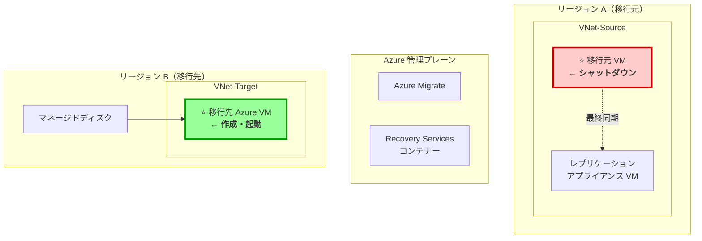

**やること:**
1. 「移行」を実行（計画移行: 移行元 VM をシャットダウン → 最終同期 → 移行先 VM 作成）
2. 移行ジョブの完了を確認
3. Azure ポータルで移行先 VM の起動を確認

---

## Phase 7: 後処理・クリーンアップ

**触る箇所**: レプリケーション停止 + 移行元リソース削除 + DNS 切り替え

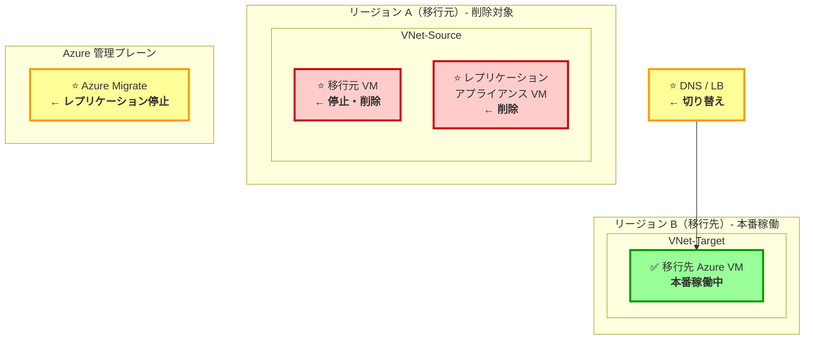

**やること:**
1. Azure Migrate で「レプリケーションの停止」
2. Windows ライセンス認証の確認
3. アプリケーション調整（ホスト名、DB 接続文字列、Web サーバー設定）
4. DNS / ロードバランサーの切り替え
5. 移行元 VM・アプライアンス VM の停止・削除
6. ドキュメント更新（IP アドレス、ロケーション情報）

---

## 凡例

| 色 | 意味 |
|---|---|
| 🟡 黄色（⭐） | そのフェーズで作成・変更する対象 |
| 🟢 緑色（✅） | 正常稼働中 |
| 🔴 赤色 | シャットダウン・削除対象 |
| 実線矢印 | データフロー |
| 点線矢印 | 制御・管理通信 |
